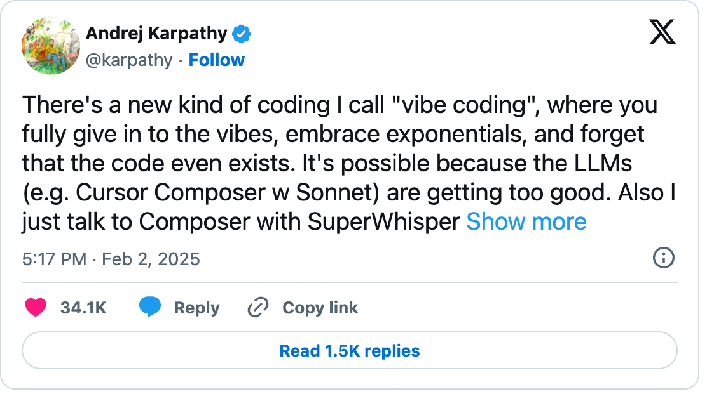
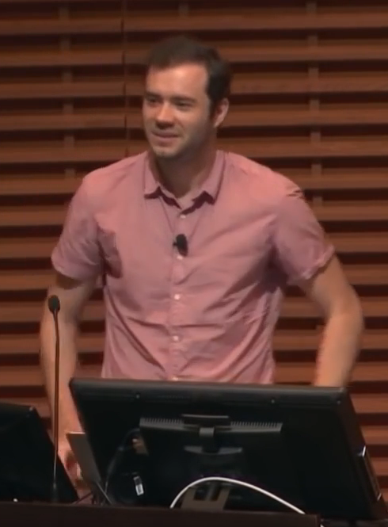
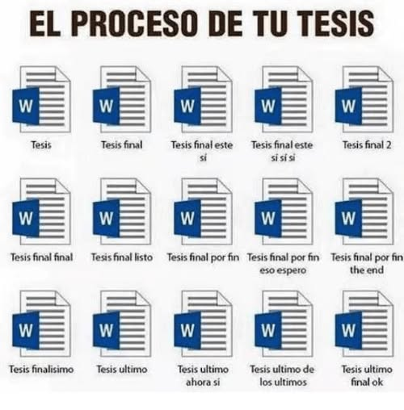

## {.center}

::: {style="text-align: center;"}
{height="600"}

[altamarmx.github.io/vibecoding-atdem]{.tiny}
:::

::: {.notes}
Mientras la gente se acomoda: escanear para seguir estas diapositivas en su dispositivo.
:::

## Tres niveles de uso de la IA

<!--
OJO: este comentario va DENTRO de la segunda diapositiva de contenido. Si se coloca
antes del primer ##, revealjs crea una diapositiva en blanco con él.

VERSIÓN ATDEM (Agencia de Transformación Digital del Estado de Morelos).
Plan de la adaptación: PLAN.md (el del webinar original: PLAN_webinar.md)

GUION DE 45 MINUTOS (43.5 + 1.5 de colchón)
  Diap. 2   QR de las diapositivas (mientras la gente llega)
  Bloque 0  Niveles de uso de IA + video del agente (3x) ... 3.5 min (diap. 3-4)
  Bloque 1  Vibe coding: definición -> tuit -> Karpathy
            -> pivote "así no se hace ciencia" ............ 4 min  (diap. 5-8, 11)
  Bloque 1b La crisis de reproducibilidad: cifras y casos ... 3 min  (diap. 9-10)
  Bloque 2  El desorden, dos niveles ...................... 3 min  (diap. 12-13)
  Bloque 3  LA PROPUESTA + Markdown, Quarto y versionado ... 4 min  (diap. 14-18)
  Bloque 4  Configuración (uv), estructura, fragmentación,
            cultura digital ............................... 5 min  (diap. 19-22)
  Bloque 5  Agentes: qué son, nube vs local ................ 3 min  (diap. 23-24)
  Bloque 6  PLAN.md, diff y pruebas (DEMOS 1 y 2) .......... 7 min  (diap. 25-30)
  Bloque 7  Spec-driven: del qmd al informe en línea ....... 2 min  (diap. 31-32)
  Bloque 8  Tendencias: paquetes, MCP, wiki, commons ....... 2 min  (diap. 33)
  Bloque 9  Una propuesta para la ATDEM .................... 4 min  (diap. 34-36)
  Bloque 10 Cierre: human in the loop, preguntas, curso .... 3 min  (diap. 37-39)

  Desactivadas (comentadas en este archivo, no borradas): "Los síntomas",
  "Una narrativa, no una receta", "Quarto mantiene todo ordenado y auditable".
  Fusibles si falta tiempo, en este orden: diap. 33 (tendencias, solo el remate)
  -> video de la diap. 4 solo el primer minuto -> fusionar 9 y 10.

Video de la diap. 4: video/005-ejecuta-plan-3x.mp4 (1:16, sin audio), generado del
original propio (youtube.com/watch?v=RYGyi0F3SSE, 3:49) con:
  uvx yt-dlp ... && ffmpeg -vf "setpts=PTS/3,fps=30" -an -c:v libx264 -crf 26
Se declara en _quarto.yml (resources: video/) para que se publique en gh-pages.

Dataset de las demos: data/ClimaLab_2026-04-08_2026-08-05 (1).parquet
  172 433 filas minutales (2026-04-08 -> 2026-08-05), 10 variables:
  tdb [C], rh [%], ghi/dni/dhi [W/m2], ws [m/s], wd [grados], p_atm, rain_acc, uv
  Verificado contra los datos reales: GHI nocturna = 0 (pasa); 2 huecos > 1 min (falla,
  a propósito para la demo); NaN: p_atm 28 747 (17 %), rh 539, ghi 2.

Marcadores:
  DEMO EN VIVO -> caja roja punteada: qué se muestra y cuánto dura
  QR (diap. 2) -> estas diapositivas: altamarmx.github.io/vibecoding-atdem
  ★ en las notas -> propuesta para la ATDEM (P1-P8 en PLAN.md)

Demos en vivo: 1 y 2 en el bloque de PLAN.md (escribir el plan; tabset diario vs
running mean 30 días). El desorden del bloque 2 se muestra solo con los listados
de las diapositivas (reales: ~/paper_enerhabitat).
-->

:::::: {.cards .tres}
::: {.card}
[1]{.num}

**Chat web**

[ChatGPT, Claude.ai, Gemini. Copiar y pegar código y datos; el contexto se pierde al cerrar la pestaña.<br>
<br>
**¿Queda registro?** No.]{.desc}
:::

::: {.card}
[2]{.num}

**App de escritorio**

[Claude Desktop y similares. Proyectos, archivos y conectores: más contexto, pero el trabajo vive en la app.<br>
<br>
**¿Queda registro?** Parcial.]{.desc}
:::

::: {.card}
[3]{.num}

**Agente en terminal**

[Claude Code (CLI). Lee, escribe y **ejecuta** en tu repositorio: corre código, ve errores, se corrige.<br>
<br>
**¿Queda registro?** Sí, **si hay estructura**: todo en git.]{.desc}
:::
::::::

::: {.vs-mal style="margin-top:0.7em;"}
**El riesgo del nivel 3: un agente *overly agentic*.** Hace **más de lo que pediste**: borra archivos ajenos a la tarea, reescribe una configuración que nunca mencionaste, "arregla" lo que no le encargaste. No es falta de capacidad: es **falta de límites**. En pruebas controladas con tareas inofensivas, los agentes de terminal se excedieron en **5–28 %** de los casos. [Qu et al., *Overeager Coding Agents*, arXiv, 2026]{.tiny}
:::

::: {.pregunta .small}
A más autonomía, más velocidad… **y más necesidad de un contrato**.
:::

::: {.notes}
Ubicar a la audiencia: casi todos están en el nivel 1, algunos en el 2. La charla vive en el nivel 3, y la pregunta transversal es la columna "¿queda registro?": en un gobierno, lo que no deja registro no se puede auditar. El vibe coding puede pasar en cualquier nivel; en el 3 sus efectos se multiplican porque el agente actúa solo. Overly agentic (en la literatura también "overeager"): el agente amplía el alcance por su cuenta. Qu et al. (arXiv 2605.18583, mayo de 2026) lo miden en 500 escenarios: Claude Code, Codex CLI y Gemini CLI entre 5.4 y 27.7 %; OpenHands, que pide confirmación, entre 0.2 y 4.5 %; y en Claude Code, quitar la declaración de qué está autorizado sube la tasa de 0 a 17 %. Lección: el permiso explícito y el alcance acotado funcionan. Eso es justo lo que hacen PLAN.md (qué sí), AGENTS.md (qué no) y leer el diff (verificar que no se salió). Anuncia el resto de la charla sin desarrollarlo.
:::

## Un agente siguiendo un contrato {.center}

:::: {style="text-align: center;"}
<video controls="" data-autoplay="" muted="" playsinline="" preload="auto" style="height: 500px; max-width: 100%; border-radius: 8px;">
<source src="video/005-ejecuta-plan-3x.mp4" type="video/mp4"/>
</video>

::: {.tiny}
Claude Code ejecutando un `PLAN.md` sección por sección, en modo automático · video acelerado **3x**, sin audio · [original en YouTube](https://www.youtube.com/watch?v=RYGyi0F3SSE)
:::
::::

::: {.notes}
Dejar correr el video (1:16 a 3x; el original dura 3:49). Mientras corre, narrar lo que se ve: el agente lee el plan, edita archivos, corre comandos, muestra el diff de cada cambio y pasa a la siguiente sección. No improvisa el alcance: el contrato le dice qué hacer y en qué orden, que es justo el antídoto contra el agente overly agentic de la diapositiva anterior. Remate: "esto es el nivel 3 con contrato; el resto de la charla es cómo se escribe ese contrato y cómo se revisa lo que hizo". Respaldo sin red: el video es local (video/), no depende de YouTube.
:::

## ¿Qué es el vibe coding? {.center}

::: {.pregunta .small}
Describir en lenguaje natural lo que quieres, aceptar lo que el modelo escribe<br>
**sin leerlo**, y corregir por prueba y error hasta que "funciona".
:::

::: {.notes}
Abrir en frío con la definición operativa: primero se nombra la práctica, sin autor. El tuit y el currículum de quien la acuñó vienen enseguida para darle peso y acotarla.
:::

## Febrero de 2025: el tuit

::: {.columns}
::: {.column width="55%"}
{width="100%"}

::: {.tiny}
Captura del embed oficial de X, @karpathy, 2 de febrero de 2025. El embed recorta el texto; [la publicación completa está aquí](https://x.com/karpathy/status/1886192184808149383).
:::
:::
::: {.column .small width="45%"}
> "Hay un nuevo tipo de programación que llamo **vibe coding**: te entregas por completo a las vibras, abrazas los exponenciales y te olvidas de que el código siquiera existe."

> "Siempre pico **'Accept All'**, ya no leo los diffs."

> "No está mal para **proyectos desechables** de fin de semana, pero sigue siendo bastante divertido."

::: {.tiny}
Traducción propia; el original en inglés está en la captura.
:::
:::
:::

::: {.notes}
Leer las dos citas en voz alta. Subrayar "desechables": el propio Karpathy lo acotó desde el principio.
Transición: ¿y quién es este señor para que su definición nos importe?
:::

## ¿Quién es Andrej Karpathy?

::: {.columns}
::: {.column width="35%"}
{height="400px"}

::: {.tiny}
Foto: Gladwin Analytics, 2019, vía Wikimedia Commons, CC BY 3.0.
:::
:::
::: {.column .small width="65%"}
- Doctorado en Stanford (2015) con [Fei-Fei Li](https://en.wikipedia.org/wiki/Fei-Fei_Li); creó y dio el curso **CS231n** de redes convolucionales.
- Miembro fundador de **OpenAI** (2015-2017); director de IA en **Tesla** (2017-2022), a cargo de la visión del Autopilot; de vuelta en OpenAI (2023-2024).
- En 2017 escribió "Software 2.0": las redes neuronales como nueva forma de programar.
- Educador: la serie **"Neural Networks: Zero to Hero"** y **Eureka Labs** (2024).
- El 2 de febrero de 2025 publicó el tuit que acuñó **vibe coding**.
:::
:::

::: {.notes}
El punto: no es un influencer ni un vendedor de herramientas. Es alguien que construyó
sistemas de producción y enseña desde los fundamentos. Por eso su definición pesa,
y por eso importa que él mismo la acotó a proyectos desechables.
:::

## Esto **no** es una manera adecuada de hacer ciencia… ni de sustentar política pública {.center}

::: {.pregunta .small}
"Accept All" sin leer los diffs produce resultados que **nadie puede verificar**:<br>
ni tú, ni tus colaboradores, ni tu yo de dentro de seis meses.
:::

<br>

[…pero el concepto **se puede transformar**:]{style="display:block; font-size:1.4em; font-weight:700; color:#1f3a5f; margin-bottom:0.4em;"}

::: {.pregunta .small}
aprovechar la **"inteligencia"** de los LLM<br>
y cambiar la confianza ciega por **estructura reproducible** y **verificación humana**.
:::

::: {.notes}
El pivote de la charla: no desechamos el concepto, lo transformamos. Velocidad sí, ceguera no. El propio Karpathy lo acotó a lo desechable; ni la ciencia ni una decisión pública son desechables. Transición: y el problema de verificar resultados no lo inventó la IA; ya existía.
:::

<!-- Bloque 1b · La crisis de reproducibilidad · 3 min -->

## La crisis de reproducibilidad es anterior a la IA

:::::: {.cards .tres}
::: {.card}
[\>70 %]{.num style="width:auto; border-radius:8px; padding:0 0.4em;"}

**de 1 576 investigadores**

[no logró reproducir el experimento de un colega; más de la mitad, ni el **propio**.<br>
[Baker, *Nature*, 2016]{.tiny}]{.desc}
:::

::: {.card}
[4 %]{.num style="width:auto; border-radius:8px; padding:0 0.4em;"}

**de 1.4 M notebooks de Jupyter**

[en GitHub dio el mismo resultado al re-ejecutarse; solo el **24 %** corrió sin error.<br>
[Pimentel et al., MSR 2019]{.tiny}]{.desc}
:::

::: {.card}
[74 %]{.num style="width:auto; border-radius:8px; padding:0 0.4em;"}

**de los scripts de R**

[depositados en Harvard Dataverse falló al re-ejecutarse (56 % tras limpieza automática).<br>
[Trisovic et al., *Sci. Data*, 2022]{.tiny}]{.desc}
:::
::::::

<br>

::: {.small}
Las causas más comunes: **dependencias sin fijar**, **estado oculto** y celdas corridas fuera de orden, **datos inaccesibles**. Ninguna es un problema de inteligencia: todas son de **estructura** y de **buenas o malas prácticas**.
:::

::: {.notes}
Tres cifras, tres escalas: personas, notebooks, repositorios de datos. Las causas que reportan Pimentel et al. (dependencias, estado oculto, orden de ejecución, datos) son exactamente lo que resuelven uv.lock, Quarto y data/001_raw/ más adelante. Mensaje: la IA no creó la crisis, pero genera código más rápido de lo que lo ordenamos; sin estructura, la acelera.
:::

## Cuando el análisis no reproducible decide

::::::::: {.columns .vs-grandes}
::::: {.column width="50%"}
:::: {.vs-mal}
**Reinhart y Rogoff (2010)**

*Growth in a Time of Debt*: deuda \> 90 % del PIB → menor crecimiento. Citado para justificar **políticas de austeridad**.

En 2013, un estudiante de doctorado (Herndon) lo reprodujo con la hoja de cálculo de los autores: un **rango mal seleccionado en Excel** omitía países, más exclusiones y ponderaciones discutibles. Con deuda \> 90 %, el crecimiento promedio no era **−0.1 %** sino **2.2 %**.

::: {.tiny}
[Reinhart y Rogoff, *AER* 100(2), 2010](https://doi.org/10.1257/aer.100.2.573) · [Herndon, Ash y Pollin, *Camb. J. Econ.* 38(2), 2014](https://doi.org/10.1093/cje/bet075)
:::
::::
:::::

::::: {.column width="50%"}
:::: {.vs-mal}
**Public Health England (2020)**

**15 841 casos de COVID-19** quedaron fuera del conteo diario (25 sep – 2 oct).

Los CSV de los laboratorios se cargaban en un formato de Excel con **límite de filas**: lo que no cabía se descartó **sin aviso**. El rastreo de contactos se retrasó.

::: {.tiny}
[The Register, 5 de octubre de 2020](https://www.theregister.com/2020/10/05/excel_england_coronavirus_contact_error/)
:::
::::
:::::
:::::::::

<br>

::: {.pregunta .small}
En gobierno, el error no se queda en un *paper*: **llega a una decisión**.
:::

::: {.notes}
Dos casos públicos y documentados; ninguno involucra IA. En ambos el cálculo "corría" y daba números plausibles. Lo que faltó fue un proceso que alguien externo pudiera reproducir y que hiciera obvio el error. Reinhart–Rogoff: el artículo original es una nota de 6 páginas en AER Papers & Proceedings (mayo de 2010), sin el arbitraje habitual de la revista. La crítica circuló en abril de 2013 como working paper de PERI-UMass (WP 322) y se publicó en Cambridge Journal of Economics (2014). Encontró tres problemas: error de codificación en Excel (rango que dejaba fuera a cinco países), exclusión selectiva de años y ponderación de los promedios. Reinhart y Rogoff reconocieron el error de Excel, pero sostienen que no cambia su conclusión de fondo; decirlo así es más honesto y no le quita fuerza al punto: el error solo se encontró porque alguien pidió la hoja de cálculo y la reprodujo. PHE: reportes de prensa y de PHE de octubre de 2020.
:::

# La pregunta ya no es **si** analizaré datos públicos con IA… {.center background-color="#1f3a5f"}

::: {.pregunta}
…sino **cómo**: ¿cómo aseguro la **reproducibilidad** y la **certeza**<br>
de que el análisis o cálculo está bien ejecutado y es **auditable**?
:::

::: {style="text-align: center; margin-top: 1em;"}
[NOTA · comentar caso UNAM, exámenes en línea: lo que salvó fueron los **datos libres** (aplausos)]{.todo}
:::

::: {.notes}
Reformular la pregunta es el giro de la charla: la adopción ya ocurrió (según la prensa, la ATDEM ya arrancó capacitación en IA para los enlaces informáticos), el problema ahora es de método. Todo lo que sigue —la propuesta, el plan, las pruebas— responde al "cómo".
:::

<!-- Bloque 2 · El proyecto desorganizado · 4 min -->

## Sin estructura, así podría verse un proyecto tras semanas de prompts

::: {.ls-grande}
```text
$ ls reporte_tramites/
Untitled.ipynb                    analisis_final.py
Untitled1.ipynb                   analisis_final_v2.py
Untitled27.ipynb                  analisis_final_v3_AHORASI.py
Sin_titulo_copia.ipynb            script_de_chatgpt.py
padron.xlsx                       arreglado_con_claude_v2.py
padron_limpio.csv                 grafica1.png
padron_limpio(2).csv              grafica1_buena.png
padron_DEFINITIVO.xlsx            grafica_final_USAR_ESTA.png
prueba.py                         tablero_v3_USAR.pbix
prueba2_funciona.py               reportes_viejos/
prueba3_no_tocar.py               reportes_viejos_2/
```
:::

::: {.pregunta .small}
Este es el nivel **evidente** del desorden. Hay otro más sutil…
:::

::: {.notes}
No burlarse: todos hemos tenido esta carpeta. El chiste es reconocerla. Con IA es peor: cada prompt genera código nuevo más rápido de lo que ordenamos el anterior. Transición: "y aunque uno ordene los scripts, hay un segundo nivel".
:::

## El nivel sutil: scripts ordenados, resultados sin narrativa

::: {.columns}
::: {.column width="42%"}
::: {.vs-bien}
**`scripts/` parece en orden**
:::

```text
00_convergence.py
01_keq_steady.py
02_comparison.py
03_comparison_figs.py
04_keq_slab.py
05_comparison_ext.py
07_bandas_esquema.py    ← ¿y el 06?
90_architecture_diagram.py
91_regen_validation_figs.py
92_regen_borbon_fig.py  ← "regen": parches
```
:::
::: {.column width="58%"}
::: {.vs-mal}
**pero `results/` ya no cuenta la historia**
:::

```text
_descartado_malla101/   ← descartes junto a lo bueno
_descartado_sur/
_flat_driver.epw        ← ¿datos de ENTRADA aquí?
_shard_B_01_02_03.log   ← logs de corridas B y C
comparison_table.tex     ┐
comparison_table_B.tex   │ ¿cuál de las cuatro
comparison_table_C.tex   │ fue al artículo?
comparison_table_all.tex ┘
series/                 ← 180 CSVs
```
:::
:::

::: {.small}
Proyecto real (el artículo de EnerHabitat). Qué produce qué —y qué terminó en el manuscrito—
vive solo en la **memoria del autor**: esa es la narrativa que se perdió.
:::

::: {.pregunta .small}
El problema no es la IA: es la falta de estructura.<br>
**Cada prompt agrega entropía si no hay contrato.**
:::

::: {.notes}
Transición a LA PROPUESTA: las herramientas que ordenan todo lo demás son viejas,
simples y aburridas: texto plano con marcas, documentos que ejecutan su código, git.
Este nivel es el de la mayoría de los proyectos de investigación: no es caos, es entropía.
Los números en los scripts prometen un orden que los resultados ya no cumplen: hay un 06
que no existe, los 90 son regeneraciones fuera del flujo, y la tabla del artículo tiene
cuatro candidatas. Honestidad: esta carpeta es mía.
:::

<!-- DESACTIVADA (recorte de tiempo; su remate se movió a "El nivel sutil"):
## Los síntomas

- Nadie —ni tú dentro de tres meses— puede **regenerar la figura 3**.
- El resultado depende del **orden en que corriste las celdas** del notebook.
- El revisor 2 pregunta de dónde salió un número y **no hay respuesta**.
- Los datos crudos fueron **sobrescritos** por una "limpieza" de la que no quedó registro.
- Hay cuatro versiones de la tabla (`_B`, `_C`, `_all`)… ¿cuál se publicó? **Nadie recuerda.**
- No hay entorno fijado: en otra máquina, **otro resultado** (¿o ni corre?).

::: {.pregunta .small}
El problema no es la IA: es la falta de estructura.
**Cada prompt agrega entropía si no hay contrato.**
:::

::: {.notes}
Transición: las dos herramientas que ordenan todo lo demás son viejas, simples y aburridas:
texto plano con marcas (Markdown) y documentos que ejecutan su propio código (Quarto).
:::
-->

<!-- Bloque 3 · La propuesta + Markdown y Quarto · 4 min -->

# La propuesta {.center background-color="#1f3a5f"}

::: {.pregunta}
**Markdown + Quarto + Python + git**<br>
una **narrativa computacional**, **versionada**,<br>
en un **ambiente virtual aislado**
:::

::: {.notes}
La respuesta al caos anterior, en una línea. Markdown para escribir y para hablar con los
agentes; Quarto para que el documento ejecute su propio código; Python para el cálculo;
git para que cada cambio quede registrado, revisable y reversible; y todo dentro de un
ambiente aislado y recreable (uv). "Narrativa computacional": el proyecto se lee de
principio a fin como una historia que corre.
:::

## ¿Qué es Markdown?

::: {.columns}
::: {.column width="50%"}
**Lo que escribes**

```markdown
# Resultados

El flujo **máximo** fue de 4.2 L/s
(ver [método](metodo.md)).

- medición directa
- modelo ajustado
```
:::
::: {.column width="50%"}
**Lo que se ve**

::: {.md-render}
[Resultados]{.md-h}

El flujo **máximo** fue de 4.2 L/s<br>(ver [método](#)).

- medición directa
- modelo ajustado
:::
:::
:::

::: {.small}
- Lenguaje de marcado **ligero** (John Gruber, 2004): texto plano legible con marcas mínimas.
- Separa **contenido** de **formato**; se versiona con git y los *diffs* se leen (a diferencia de un `.docx`).
- Es el idioma nativo de GitHub **y de los LLMs**: `README.md`, `PLAN.md`, `AGENTS.md`.
:::

::: {.notes}
La clave para esta charla: cuando hablas con un agente, hablas en Markdown.
El plan, las reglas y la bitácora van a ser archivos .md dentro del repositorio.
:::

## ¿Qué es Quarto?

::: {.small}
- Sistema de **publicación científica y técnica** de código abierto (Posit; sucesor de R Markdown) · [quarto.org](https://quarto.org)
- Un `.qmd` = Markdown + bloques de código **ejecutables** (Python, R, Julia) + opciones en YAML.
:::

::::::: {.columns}
:::: {.column width="52%"}
**El fuente** (`index.qmd`)

::: {.resalta-python}
````{.markdown code-line-numbers="9-13"}
---
title: "Análisis de mediciones"
format: html
---

Los datos muestran un máximo
en verano (@fig-serie).

```{{python}}
#| label: fig-serie
#| fig-cap: "Serie de la medición"
df.plot(x="fecha", y="flujo_l_s")
```
````
:::
::::

:::: {.column width="48%"}
**Cómo se convierte**

```bash
quarto render index.qmd   # → HTML
quarto render --to pdf    # → PDF (LaTeX)
quarto render --to docx   # → Word
quarto render --to revealjs  # → diapos
```

**Y mientras escribes:** `quarto preview`

::: {.small}
Deja el documento **vivo en el navegador**: cada vez que guardas, se re-ejecuta y refresca solo — escribes y **ves el resultado al instante**.
:::
::::
:::::::

::: {.pregunta .small}
Estas diapositivas están hechas en Quarto — y se construyeron con `quarto preview`.
:::

::: {.notes}
Señalar las tres piezas en el ejemplo: YAML arriba (opciones documentadas), texto en Markdown con referencia cruzada, celda de Python con etiqueta y pie de figura.
:::

## Por qué juntos: el análisis **es** el documento {.center}

::::::: {.columns .vs-grandes}
:::: {.column width="50%"}
::: {.vs-mal}
**El flujo de siempre**

1. Script que genera figuras
2. Copiar y pegar al informe o al tablero
3. Cambian los datos…
4. …repetir a mano y rezar

Texto y código **divergen** desde el día uno.
:::
::::

:::: {.column width="50%"}
::: {.vs-bien}
**Con Quarto**

1. Texto, código, opciones y resultados en **un solo archivo** versionado
2. Cambian los datos → `quarto render`
3. Figuras, tablas y números se **regeneran solos**

El documento no puede mentir sobre su código.
:::
::::
:::::::

::: {.notes}
Frase ancla: "el análisis ES el documento". No hay un script por un lado y un Word por el otro. Esto es lo que vuelve auditable el trabajo hecho con IA: todo lo que la IA escribió está a la vista.
:::

## ¿Qué es el versionado?

::::: {.columns}
::: {.column width="40%"}
{height="460"}
:::

::: {.column .small width="60%"}
- Todos hemos versionado **a mano**: `tesis_final_por_fin_eso_espero.docx`, `informe_trimestral_final_v3.xlsx`.
- Un **sistema de control de versiones** —**git**— guarda la historia completa del proyecto: quién cambió **qué**, **cuándo** y **por qué**. Un solo archivo, todas sus versiones.
- Cada *commit* es un punto de retorno: equivocarse deja de ser caro, y el *diff* entre versiones siempre se puede leer.
- **git es software libre**: se puede hospedar en un **servidor propio del Estado** (GitLab, Forgejo) y el código queda **bajo control estatal**; o en **GitHub**, donde publico estas diapositivas.
:::
:::::

::: {.notes}
El meme hace el trabajo: todos reconocen esa carpeta. git reemplaza los nombres de archivo por una historia con autor, fecha y mensaje de cada cambio. Precisión: git (el versionador) es software libre; GitHub es una plataforma que lo hospeda, no la única. ★ ATDEM: la Ley de Transformación Digital (art. 100 IV) pide "código fuente disponible para auditoría… bajo control estatal" y (art. 100 V) privilegiar tecnologías abiertas. Un servidor git institucional cumple ambas cosas con software libre.
:::

<!-- Bloque 4 · Configuración (uv), estructura y flujo · 6 min -->

## Todo empieza por el entorno: `uv` {.center}

::: {.small}
[**uv**](https://docs.astral.sh/uv/), de **Astral**: gestor de proyectos y paquetes de Python, de código abierto y muy rápido · [docs.astral.sh/uv](https://docs.astral.sh/uv/)
:::

::: {.ls-grande}
```bash
uv init analisis-climalab          # proyecto + ambiente virtual + pyproject.toml
uv add pandas pyarrow matplotlib   # instala y FIJA versiones en uv.lock
uv run quarto render               # todo corre dentro del ambiente
```
:::

- Un solo gestor: proyecto, versión de Python y paquetes; el ambiente virtual deja de ser un trámite.
- `uv.lock` registra versiones exactas: **la misma ciencia en otra máquina**.
- El espacio nace **con narrativa**: `pyproject.toml` dice qué es el proyecto, `uv.lock` con qué corre, `PLAN.md` y `AGENTS.md` bajo qué reglas.
- El contrato declara la herramienta: *"instala con `uv add`, ejecuta con `uv run`"* — el agente **no improvisa** un `pip install` fuera del ambiente.

::: {.notes}
Si el agente sabe con qué instalar, no contamina el sistema ni rompe el ambiente: cada paquete que agrega queda fijado en uv.lock y el commit lo registra.
:::

## Estructura propuesta

```text
proyecto/
├── PLAN.md                # contrato + bitácora de IA + decisiones + ficha de metadatos
├── AGENTS.md              # reglas del espacio de trabajo para el agente
├── pyproject.toml         # entorno fijado con uv
├── uv.lock
├── data/
│   ├── 001_raw/           # inmutable: los datos crudos nunca se tocan
│   ├── 002_intermediate/  # datos procesados
│   └── 003_results/       # resultados del análisis
├── src/proyecto/          # funciones importables, cada una con prueba
├── tests/                 # pruebas físicas (pytest)
├── analysis/
│   └── index.qmd          # la narrativa computacional del análisis
└── tex/                   # opcional: el informe o artículo; recibe las figuras
                           # y tablas que index.qmd declara FINALES
```

::: {.small}
Es una **narrativa, no una receta**: la estructura se adapta al proyecto y a sus datos. Lo que no cambia: crudos intocables · entorno fijado · funciones con pruebas · análisis en `.qmd`.
:::

::: {.notes}
Recorrer de arriba a abajo: primero los contratos (PLAN, AGENTS), luego el entorno, luego datos con crudos intocables y resultados en data/003_results/, funciones probadas, el análisis en un solo index.qmd, y tex/ con el artículo. PLAN.md concentra también la bitácora de IA y las decisiones: por eso no hay docs/. Detalle para la demo: el parquet llegó como "ClimaLab_2026-04-08_2026-08-05 (1).parquet", con espacio y "(1)". Moverlo a data/001_raw/ con nombre limpio es parte de la narrativa; su origen y fecha quedan anotados en la sección Datos del PLAN.md. ★ ATDEM: esa sección Datos (origen, fecha, variables, unidades) es ya una ficha de metadatos: puede alimentar el Inventario de Datos que pide el art. 122 de la Ley.
:::

<!-- DESACTIVADA (recorte de tiempo; su mensaje se movió a "Estructura propuesta"):
## Una narrativa, no una receta

::: {.small}
La estructura **se adapta al proyecto y a sus datos**: series de tiempo, imágenes, encuestas…
cada uno pide carpetas distintas. Lo que no cambia:
:::

::: {.cards}
::: {.card}
[1]{.num}

**Datos crudos intocables**

[`data/001_raw/` nunca se sobrescribe; su origen queda anotado en `PLAN.md`.]{.desc}
:::

::: {.card}
[2]{.num}

**Entorno fijado**

[`uv.lock`: las mismas versiones en tu máquina, la del agente y la del revisor.]{.desc}
:::

::: {.card}
[3]{.num}

**Funciones con pruebas**

[Todo cálculo que importa vive en `src/` y tiene su prueba en `tests/`.]{.desc}
:::

::: {.card}
[4]{.num}

**Análisis en `.qmd`**

[El código a la vista, las opciones documentadas, el render regenerable.]{.desc}
:::
:::

::: {.notes}
Insistir: no es plantilla rígida. Es una narrativa que cuenta de dónde vienen los datos
y cómo se convierten en el artículo. Los cuatro invariantes sí son innegociables.
:::
-->

## La fragmentación: así se publica la cifra incorrecta

```text
 se analiza            se genera                 se manda             se agrega           se publica
datos + código  ──►  grafica_v2_FINAL.png  ──►  por correo  ──►  a mano al informe  ──►  el PDF/portal
```

::: {.small}
- El análisis en una compu, el informe en otra, y la figura **viajando por correo**: cada flecha es un paso **manual, invisible y sin registro**.
- Si el dato cambia después del envío, el informe conserva la **figura vieja** — y nadie lo nota hasta que está publicado.
- Todos tenemos la anécdota del informe con la **cifra incorrecta**. No es descuido: es la fragilidad del proceso.
:::

<br>

::: {.pregunta .small}
La cura no es otra flecha: es un **proceso continuo** en un repositorio compartido,<br>
que asegura la reproducibilidad y hace **obvio** cuándo algo se rompe —<br>
todo comandado por `uv run quarto render`.
:::

::: {.notes}
Contar aquí la anécdota propia (o invitar a la audiencia a recordar la suya). El contraste con la estructura anterior: allá cada flecha vive en el repositorio y se regenera con un comando; aquí cada flecha vive en un correo y en la memoria de alguien. Datos, código y resultados no deben fragmentarse entre computadoras y personas: quien llega clona, sincroniza y reproduce.
:::

## No basta con herramientas: hace falta **cultura digital**

::::::::: {.cards .tres}
::: {.card}
[1]{.num}

**Flujos de trabajo sólidos**

[Un repositorio compartido, cada paso convertido en comando; nada viaja por correo.]{.desc}
:::

::: {.card}
[2]{.num}

**Buenas prácticas**

[Crudos intocables, entorno fijado, pruebas, commits pequeños con mensaje claro.]{.desc}
:::

::: {.card}
[3]{.num}

**Revisión entre pares**

[Nadie publica solo: otra persona lee el diff y reproduce el resultado antes de firmar.]{.desc}
:::

::: {.card}
[4]{.num}

**Documentación y metadatos**

[`PLAN.md` y README: de dónde vienen los datos, qué se decidió y por qué.]{.desc}
:::

::: {.card}
[5]{.num}

**Abierto por defecto**

[Datos y código libres siempre que la ley lo permita: lo que se puede revisar, se puede corregir.]{.desc}
:::

::: {.card}
[6]{.num}

**Formación continua**

[Terminal, git, Python, Quarto: saber **leer** código es la condición para auditar a la IA. Y **evaluar nuevas tecnologías** antes de adoptarlas.]{.desc}
:::
:::::::::

::: {.pregunta .small}
La herramienta se instala en un día; la **cultura** se construye:<br>
práctica, reglas claras y errores que se **reportan**, no se esconden.
:::

::: {.notes}
Puente entre la parte técnica y la institucional: todo lo anterior (Markdown, Quarto, git, uv, estructura) falla si cada quien trabaja a su manera. Por eso "cultura digital" es uno de los cinco pilares del plan semestral de la ATDEM. Lo que más falta, en orden de dificultad: (1) revisión entre pares, porque obliga a que alguien más pueda reproducir; (2) reportar errores sin castigo: una prueba que falla es información, no un fracaso; (3) apertura por defecto, que convierte a la ciudadanía en revisora (enlaza con el caso UNAM: lo que salvó fueron los datos libres). Pregunta a la sala si da tiempo: "¿cuál de las seis tiene hoy su dependencia?"
:::

<!-- Bloque 5 · Agentes · 4 min -->

## ¿Qué es un agente?

::: {.pregunta .small}
Agente = LLM + un bucle de **herramientas**<br>
(leer y escribir archivos, ejecutar comandos, correr pruebas)<br>
que itera hasta cumplir una tarea.
:::

::: {.small}
- Es el **nivel 3** de la escalera del inicio: a diferencia del chat, **actúa sobre tu repositorio**: crea archivos, corre código, ve los errores y se corrige.
- Por eso necesita **reglas** (`AGENTS.md`) y un **contrato** (`PLAN.md`): sin ellos, optimiza "que no truene", no "que esté bien".
- El ciclo: lee el plan → propone acción → ejecuta herramienta → observa el resultado → repite.
:::

::: {.notes}
Diferencia clave con copiar/pegar desde el chat: el agente cierra el ciclo solo. Eso multiplica la velocidad y también multiplica el daño si no hay reglas. La mención de PLAN.md anuncia el bloque que sigue: el contrato.
:::

## Agentes en la nube y agentes locales {.center}

::::::: {.columns .vs-grandes}
:::: {.column width="50%"}
::: {.vs-bien}
**Nube — mi caso: Claude (Claude Code)**

- Modelos de frontera, los más capaces
- Sin hardware propio
- Costo por uso
- Los datos **salen de tu máquina**
- **En gobierno:** datos públicos y abiertos
:::
::::

:::: {.column width="50%"}
::: {.vs-mal}
**Local — también uso Qwen3.8 27B** (`qwen3.8:27b-mlx`)

- Los datos **no salen**; sin costo por token
- Exige **hardware capaz**: aquí corre vía **MLX** en Apple Silicon con memoria unificada amplia (o GPU con VRAM suficiente)
- Rinde menos que los modelos de frontera: hay que **evaluar sus capacidades** y si es **adecuado para la tarea** antes de adoptarlo
- **En gobierno:** datos personales y padrones, en **infraestructura del Estado**
:::
::::
:::::::

::: {.notes}
Ser honesto con la restricción local: no es gratis, se paga en hardware y en capacidad del modelo. La decisión es por tipo de dato, no ideológica: nube para el trabajo pesado con datos públicos; local cuando los datos no deben salir. ★ ATDEM: el centro de datos estatal en planeación es el lugar natural para un modelo local que atienda a las dependencias que manejan datos personales (protección de datos personales en posesión de sujetos obligados).
:::

<!-- Bloque 6 · PLAN.md, diff y pruebas · 7 min -->

## PLAN.md: el contrato con el agente

::::: {.columns}
::: {.column width="55%"}
```markdown
# PLAN · Clima ClimaLab (abr–ago 2026)

## Objetivo
Caracterizar temperatura, radiación
y viento de la estación.

## Datos
climalab_2026-04-08_2026-08-05.parquet
172 433 filas · cadencia 1 min
tdb [°C] · rh [%] · ghi/dni/dhi [W/m²]
ws [m/s] · wd [°] · p_atm · rain_acc

## Herramientas
Instalar con `uv add`, correr con `uv run`.
Tras cada cambio de código: mostrar
el `git diff` y esperar revisión.

## Pasos
1. Validar crudos con pruebas físicas
2. Huecos y NaN → data/002_intermediate/
3. Día típico, rosa de viento, GHI diaria

## Criterios de aceptación
- `pytest` pasa · GHI nocturna = 0
- Figuras regenerables con `quarto render`

## Bitácora y decisiones
Qué propuso la IA, qué decidió
la persona autora, y por qué.
```
:::

::: {.column .small width="45%"}
- Se escribe **antes** de pedir una sola línea de código.
- Dice **qué** quieres de los datos: preguntas, variables, **unidades**, supuestos.
- Y **con qué**: la sección de herramientas le dice al agente cómo instalar, ejecutar y **mostrar el diff** de cada cambio.
- `git commit` del plan = **firma del contrato**.
- Cada sección es una unidad de trabajo para el agente.
- Es también la **bitácora**: las decisiones de la persona autora quedan en el repo, no en la memoria.
:::
:::::

::: {.notes}
El corazón de la charla empieza aquí. El plan no es burocracia: es lo que convierte "hazme el análisis" en una secuencia de encargos verificables.
:::

## Cómo se escribe: el LLM propone, el humano corrige

::: {.small}
El borrador de la IA **puede traer supuestos erróneos** —unidades, convenciones, casos límite—
y corregirlos en el plan cuesta minutos; corregirlos en el código, días.
:::

::: {.demo}
[Demo en vivo 1 · ≤ 2 min]{.demo-title}
"Escribe `PLAN.md` para caracterizar el clima a partir del parquet de ClimaLab.<br>**No escribas código.**"
:::

::: {.notes}
Mensaje: la revisión más barata del proyecto es la del plan.
Es el único momento donde corregir no implica reescribir nada.
Errores esperables del borrador (no adelantarlos en pantalla): asume datos horarios
(son minutales), promedia la dirección del viento aritméticamente, y no dice qué hacer
con los NaN de p_atm (17 % de la serie). Leer el borrador en voz alta y corregirlos
antes del commit.
:::

## Leer el diff: la unidad de revisión

::: {.small}
El **diff** es la lista exacta de lo que cambió: líneas que salen (`-`) y líneas que entran (`+`).
Con agentes es **el** instrumento de revisión: no relees todo el archivo, lees **el cambio**.
:::

```diff
$ git diff src/proyecto/radiacion.py

 def ghi_diaria(ghi_w_m2):
     """GHI diaria en kWh/m² por día."""
-    wh = ghi_w_m2 * (1 / 60)               # cada muestra [W/m²] dura 1 min
-    return wh.resample("1D").sum() / 1000
+    return ghi_w_m2.resample("1D").mean() / 1000
```

::: {.small}
- El agente "simplificó" el cálculo… y cambió `sum()` por `mean()`: eso ya no es **energía diaria** [kWh/m²·día], es **potencia promedio** [kW/m²].
- El código corre sin error y los números salen con pinta razonable: **solo el diff lo delata**.
:::

::: {.notes}
Caso ficticio pero típico: el cambio compila, no truena y el número es plausible.
Dos líneas rojas y una verde: leerlas toma veinte segundos y evita una figura incorrecta
publicada. Prepara la demo que sigue (ahí se lee un diff en vivo) y conecta con las
pruebas de más adelante: una prueba con respuesta conocida también lo habría cazado —
diff y pruebas son redundancia deliberada.
:::

## Demo en vivo: ejecutar el plan, parte por parte

::: {.pregunta .small}
Nunca "hazme todo el análisis".<br>
Una sección del plan → código → render → **leer el diff** → commit.
:::

::: {.demo}
[Demo en vivo 2 · ≤ 3 min]{.demo-title}
Con el agente, en `analysis/index.qmd`: la temperatura de ClimaLab en **dos pestañas** —<br>
**(1)** promedio **diario** y **(2)** *running mean* de **30 días**.<br>
Las pestañas son para **decidir con cuál me quedo**, conservando **ambas opciones**
en el mismo documento para discutirlas con mi equipo.
:::

**El truco de Quarto — un *tabset*:**

```markdown
::: {.panel-tabset}
#### Promedio diario
tdb.resample("1D").mean()

#### Running mean 30 días
tdb.resample("1D").mean().rolling(30).mean()
:::
```

::: {.small}
Por eso importa **aprender Quarto** y conocer sus capacidades —tabsets, referencias cruzadas,
opciones de celda, formatos—: **no puedes pedirle al agente lo que no sabes que existe.**
:::

::: {.notes}
Una vuelta completa del ciclo, en vivo: pedir la sección al agente, ver el código aparecer,
leer el diff, render. Las pestañas materializan una decisión de análisis sin destruir la
alternativa: el documento conserva las dos vistas y el equipo decide viéndolas.
El tabset lo pedí yo, no lo propuso el agente: conocer la herramienta define qué puedes exigir.
Cada vuelta es pequeña: si algo sale mal, el diff es corto. Lo contrario de "Accept All".
Respaldo por si falla la red/el agente: captura del render ya hecho.
:::

## Data testing: una respuesta conocida de antemano

::::: {.columns}
::: {.column width="44%"}
**La función** (escrita por el agente)

```python
# src/proyecto/energia.py
def calcular_energia(potencia_w, freq="1h"):
    """Potencia [W] → energía [Wh],
    agregada a la frecuencia freq."""
    paso = (potencia_w.index[1]
            - potencia_w.index[0])
    dt_h = paso.total_seconds() / 3600
    return (potencia_w * dt_h).resample(freq).sum()
```
:::

::: {.column width="56%"}
**La prueba** (datos inventados por la persona autora)

```python
# tests/test_energia.py
def test_energia_con_respuesta_conocida():
    # 1200 W constantes, 2 horas, cada minuto
    idx = pd.date_range("2026-01-01",
                        periods=120, freq="1min")
    potencia = pd.Series(1200.0, index=idx)

    energia = calcular_energia(potencia, freq="1h")

    # con papel y lápiz: 1.2 kW × 1 h = 1200 Wh
    assert (energia == 1200.0).all()
    assert energia.sum() == 2400.0
```
:::
:::::

::: {.small}
- La persona autora **inventa datos cuya respuesta conoce sin correr el código**: potencia constante → la energía se calcula con papel y lápiz.
- Si el agente toca la función y el total deja de ser 2400 Wh, `pytest` **truena en el acto**.
- Eso es una prueba: una afirmación que **no depende de confiar** en quien escribió el código.
:::

::: {.notes}
El ejemplo más claro del concepto: el ground truth lo pone la persona, no el código. Señalar la frecuencia del resample como parámetro: la misma prueba se puede repetir con freq="15min" (300 Wh por cuarto de hora). Verificado: estos asserts pasan tal cual.
:::

## Las pruebas son parte del plan

::: {.small}
Cada afirmación verificable del plan se convierte en una **prueba física** con pytest. Estas tres corren sobre los datos reales de ClimaLab, con el resultado real:
:::

```python
def test_radiacion_nocturna():        # PASA: el piranómetro está bien
    noche = df.between_time("22:00", "04:00")
    assert (noche["ghi"] == 0).all()

def test_rangos_fisicos():            # PASA: rh en [0, 100], ws ≥ 0
    assert df["rh"].between(0, 100).all()
    assert df["ws"].ge(0).all()

def test_serie_completa():            # FALLA: hay 2 huecos > 1 min
    saltos = df.index.to_series().diff()
    assert not (saltos > pd.Timedelta("1min")).any()
```

::: {.small}
- La prueba que **falla** no es un fracaso: obliga a decidir (¿interpolar?, ¿dejar el hueco?) y a **documentar la decisión**.
- Las pruebas **físicas** detectan lo imposible; la **referencia externa** detecta lo plausible pero incorrecto.
- Ojo con las pruebas tautológicas que proponen los LLM: prueban que el código hace lo que el código hace.
- Es lo que la ley llama datos **"ciertos, consistentes, íntegros"** (art. 121), convertido en código.
:::

::: {.notes}
Aquí entra el "pruebas" del título. No son pruebas de software por cumplir: son las afirmaciones del plan convertidas en código que vigila al agente. ★ ATDEM: el art. 121 II de la Ley de Transformación Digital enumera atributos de calidad de datos; cada uno se puede volver una prueba que corre en cada render.
:::

<!-- Bloque 7 · Spec-driven · 5 min -->

## Esto ya tiene nombre: *spec-driven development* {.center}

::::::: {.columns .vs-grandes}
:::: {.column width="50%"}
::: {.vs-mal}
**Vibe coding (Karpathy)**

- El prompt es la especificación
- El código **no se lee**
- "Accept All"
- Para proyectos **desechables**
:::
::::

:::: {.column width="50%"}
::: {.vs-bien}
**Spec-driven (lo que acabamos de hacer)**

- `PLAN.md` **firmado** es la especificación
- El agente ejecuta el spec; el humano lo escribe y lo **verifica**
- Diff leído, pruebas pasando, commit
- Para trabajo que **se publica** o **sustenta una decisión pública**
:::
::::
:::::::

::: {.notes}
Nombrar lo que ya hicimos en el bloque anterior: no inventamos nada, es la misma transición que está dando la industria del software con los agentes.
:::

<!-- DESACTIVADA (recorte de tiempo; el punto de las opciones de celda se dice
de palabra en "Del .qmd al informe en línea": "cada opción queda escrita y versionada"):
## Quarto mantiene todo ordenado y auditable

::: {.small}
- El **código a la vista** en el documento: lo que la IA escribió no se puede esconder.
- Las **opciones documentadas**: el YAML y las opciones de celda dicen cómo se generó cada salida.
- Los **resultados regenerables** con un solo comando.
:::

````markdown
```potluoogjf
#| label: fig-serie
#| fig-cap: "Flujo medido vs. modelo"
#| echo: true          # el código se muestra: auditable
#| warning: false      # decisión explícita y versionada
fig = comparar(df_medido, df_modelo)
```
````

::: {.small}
Cada decisión de presentación queda **escrita y versionada**, no en la memoria de quien hizo la figura.
:::

::: {.notes}
Esto responde "¿y dónde reviso lo que hizo la IA?": en el qmd y en el diff.
No hay celdas ocultas ni estados de notebook fuera de orden.
:::
-->

## Del `.qmd` al informe en línea y al portal de datos abiertos

::: {.small}
- El informe **es** el `.qmd`: Quarto lo convierte a **HTML** y lo **publica en línea**. No hay documento aparte al que copiar figuras.
- La misma corrida escribe el `.csv` para el **Portal de Datos Abiertos**: informe y datos salen del mismo código.
:::

:::::: {.columns}
::: {.column width="55%"}
**En `analysis/index.qmd`**

````markdown
```{{python}}
#| label: tbl-temp-mensual
#| tbl-cap: "Temperatura promedio mensual [°C]"
mensual = tdb.resample("MS").mean()
mensual.to_csv("data/003_results/temp_mensual.csv")
mensual.to_frame()
```
````
:::

:::: {.column width="45%"}
**Y para publicarlo**

```bash
uv run quarto render            # → informe HTML
uv run quarto publish gh-pages  # → en línea, con URL
```

::: {.small}
O en un **servidor del Estado**: el HTML es un sitio estático. Cada versión publicada sale de un **commit**: siempre se sabe qué código produjo qué cifra. Estas diapositivas se publican igual.
:::
::::
::::::

::: {.small}
Quien audita regenera todo con `uv sync --locked && uv run quarto render`.
:::

::: {.notes}
El salto respecto al flujo de siempre: el informe ya no es un Word o PDF que circula por correo, es una página con URL, versionada y regenerable. La tabla del informe y el CSV del portal salen de la misma celda: no pueden contradecirse. Si alguien pide Word para el oficio: `quarto render --to docx` desde el mismo .qmd; se dice de palabra solo si preguntan. Cierra el ciclo completo: dato crudo → análisis → tabla → informe HTML + CSV.
:::

<!-- Bloque 8 · Tendencias actuales y a futuro · 2 min -->

## Tendencias actuales y a futuro

::::::: {.cards}
::: {.card}
[1]{.num}

**Paquetes instalables** · [EnerHabitat en PyPI](https://pypi.org/project/enerhabitat/) (`uv add enerhabitat`)

[Cuando `src/` crece, se vuelve paquete: documentado, versionado, **citable**. En gobierno: bibliotecas compartidas entre dependencias, una sola función probada y no veinte copias (art. 100 V).]{.desc}
:::

::: {.card}
[2]{.num}

**Herramientas para agentes** · [MCP](https://modelcontextprotocol.io)

[Estándar abierto para exponer funciones y datos como **herramientas que cualquier agente invoca**: deja de *reescribir* tus cálculos y pasa a **llamarlos**. Ejemplo: el Inventario de Datos como servidor MCP.]{.desc}
:::

::: {.card}
[3]{.num}

**Bases de conocimiento** · [LLM Wiki, Karpathy](https://gist.github.com/karpathy/442a6bf555914893e9891c11519de94f)

[Fuentes intocables en `raw/` (la ley, lineamientos) → wiki en Markdown que el LLM escribe **con citas** → reglas en `AGENTS.md`, todo en **git**.]{.desc}
:::

::: {.card}
[4]{.num}

**Agentes de análisis confiables** · [commons, Posit](https://posit-dev.github.io/commons/)

[Usa primero **tu código validado**; cada respuesta lleva una etiqueta según su respaldo: 🟢 función validada · 🔵 contexto citado · 🟡 sin respaldo.]{.desc}
:::
:::::::

::: {.pregunta .small}
La misma dirección: código y conocimiento **verificados** que el agente usa en vez de improvisar.
:::

::: {.notes}
Paquetes: EnerHabitat, simulación de la transferencia de calor en envolventes, IER-UNAM. El mensaje no es "publiquen paquetes": la estructura de este flujo (src/ + tests/) deja el paquete casi listo, y sus versiones quedan fijadas en el uv.lock de quien lo usa. Orden de la diapositiva: de lo que ya existe y se usa (paquetes, MCP) a lo emergente (LLM Wiki, commons). commons (Posit): paquete de R y Python para "trustworthy data analysis agents"; corre sobre ellmer/chatlas/shinychat con cualquier proveedor de modelos. La versión de Python está en beta. Enlaza directo con lo de hoy: src/ con funciones probadas es exactamente el "código confiable" que commons pone primero, y la etiqueta amarilla es la versión automática de "no lo publiques sin prueba". MCP: modelcontextprotocol.io. Cierra el arco de Karpathy: la charla abrió con el Karpathy del vibe coding desechable y aquí aparece el Karpathy que estructura el conocimiento en Markdown versionado. Matiz honesto: la wiki la escribe el LLM, y los errores se acumulan si nadie la revisa; cada página cita su fuente cruda y la revisión entra por el diff, igual que el código. Es reproducibilidad del conocimiento, no del análisis: por eso va a futuro. ★ ATDEM: wiki de la normativa (Ley de Transformación Digital, lineamientos, plan semestral) para que los Agentes de Transformación Digital consulten con cita al artículo. Ejemplo vivo: el plan de esta charla salió de bajar la ley, pasarla a texto y citarla por artículo. Fusible: si falta tiempo, se dice solo el remate de abajo en 30 segundos.
:::

<!-- Bloque 9 · Una propuesta para la ATDEM · 4 min -->

# Una propuesta para la ATDEM {.center background-color="#1f3a5f"}

::: {.pregunta}
La Ley de Transformación Digital **ya lo pide**;<br>
este flujo es **una forma de cumplirlo**.
:::

::: {.notes}
Cambio de registro: de la técnica a la institución. No se vende algo nuevo: se aterriza lo que la ley (POEM 6475, 3 de octubre de 2025) ya le encarga a la Agencia.
:::

## Lo que la ley ya pide, y dónde vive en este flujo

::::::: {.columns .vs-grandes}
:::: {.column width="50%"}
::: {.vs-ley}
**Ley de Transformación Digital del Estado de Morelos**

- **Art. 100 IV** · código fuente disponible para auditoría
- **Art. 101** · auditorías periódicas, incluida la documentación
- **Art. 121** · datos ciertos, consistentes, comparables, íntegros
- **Art. 122** · Inventario de Datos con metadatos
- **Art. 17 LIX** · uso ético, seguro y responsable de la IA
- **Art. 120 II** · capacitar en datos a los Agentes de TD
:::
::::

:::: {.column width="50%"}
::: {.vs-bien}
**En este flujo**

- Repositorio git + **diff** de cada cambio
- `git log` + `PLAN.md` como bitácora + **pruebas**
- **Pruebas físicas** que corren en cada render
- Sección **Datos** del `PLAN.md` = ficha de metadatos
- `AGENTS.md` + **humano que firma** cada commit
- Formación práctica: de la terminal al informe
:::
::::
:::::::

::: {.notes}
Leer de izquierda a derecha, renglón por renglón: cada atribución tiene un artefacto concreto que la cumple. Los artículos están verificados contra el texto de la ley (versión SCJN). El art. 17 XLV además dice que ningún proyecto digital arranca sin aprobación de la Agencia: el PLAN.md es un buen formato para esa solicitud.
:::

## Propuesta en cuatro piezas

::::::: {.cards}
::: {.card}
[1]{.num}

**Lineamiento de análisis reproducible**

[Todo producto analítico que se publique o sustente una decisión vive en un repositorio con `PLAN.md`, `uv.lock`, pruebas y un `.qmd` que lo regenera.]{.desc}
:::

::: {.card}
[2]{.num}

**`AGENTS.md` institucional**

[Reglas comunes para todo agente de IA en repositorios del Estado: qué datos no salen, con qué se instala, qué no se toca.]{.desc}
:::

::: {.card}
[3]{.num}

**Nube o local según el dato**

[Datos públicos → modelos en la nube. Datos personales y padrones → modelo local en el **centro de datos estatal**.]{.desc}
:::

::: {.card}
[4]{.num}

**Piloto de 90 días**

[Un Agente de Transformación Digital lleva un conjunto de datos de **digital.morelos** de crudo a portal con este flujo; opcional: la wiki de la normativa.]{.desc}
:::
:::::::

::: {.notes}
Las cuatro piezas son baratas: software libre y lineamientos. Lo caro (hardware para modelo local) se monta sobre el centro de datos que ya está en planeación. El piloto es la prueba de concepto: un conjunto de datos, una persona, 90 días, y al final cualquiera lo regenera con uv sync –locked && uv run quarto render. La formación (pieza 5, implícita) va en la última diapositiva.
:::

<!-- Bloque 10 · Cierre · 3 min -->

## Saber programar es la licencia de conducir

::: {.cards .tres}
::: {.card}
[A]{.num}

**Auditar**

[Sin leer código no puedes revisar lo que el agente escribe: el diff es tu instrumento.]{.desc}
:::

::: {.card}
[B]{.num}

**Entender**

[El criterio de dominio decide si el número es plausible; la IA no sabe lo que no le dijiste.]{.desc}
:::

::: {.card}
[C]{.num}

**Guiar**

[*Human in the loop*: el plan, las correcciones y la firma son humanas. La IA no firma.]{.desc}
:::
:::

<br>

::: {.pregunta .small}
La IA sube el **piso**; el **techo** —criterio, verificación, firma— sigue siendo humano.
:::

::: {.notes}
Cerrar el arco: del vibe coding (código sin leer) a la ciencia reproducible
(spec firmado, código auditado, pruebas, reproducción desde cero).
:::

## {.center}

[¿Preguntas?]{style="display:block; font-size:2.2em; font-weight:700; color:#1f3a5f; text-align:center; margin-bottom:0.4em;"}

::: {.pregunta .small}
Y una para ti: ¿qué dato de tu dependencia **no** publicarías sin una prueba, y por qué?
:::

<br>

::: {.small style="text-align: center;"}
Guillermo Barrios del Valle · gbv@ier.unam.mx · Instituto de Energías Renovables, UNAM

Diapositivas y repositorio: [altamarmx.github.io/vibecoding-atdem](https://altamarmx.github.io/vibecoding-atdem/) · [github.com/AltamarMx/vibecoding-atdem](https://github.com/AltamarMx/vibecoding-atdem)
:::

::: {.notes}
Dejar en pantalla durante el Q&A. Preguntas sembradas para quien modera, en este orden: 1. Datos personales: "¿Podemos usar agentes con los datos de los padrones?" (→ diapositiva nube vs local; modelo local en el centro de datos estatal). 2. Auditoría: "Si el agente escribió el código, ¿quién responde y cómo se audita?" (→ la persona firma el commit; diff + pruebas + git log; art. 101). 3. Costo: "¿Esto requiere comprar licencias?" (→ git, Quarto, Python y uv son software libre; el costo es el modelo en la nube o el hardware local). 4. Verificación: "Si el agente escribe el código Y las pruebas, ¿quién vigila al vigilante?" (→ pruebas tautológicas; la respuesta conocida la pone la persona; diff + pruebas = redundancia deliberada). 5. Formación: "¿Cómo se conecta con la capacitación en IA que ya está en marcha?" (→ diapositiva siguiente).
:::

## Formación para Agentes de Transformación Digital

::: {.pregunta .small}
**De la terminal al informe:<br>
ciencia de datos reproducible con Python, Quarto y agentes de IA**
:::

::::: {.columns .small}
::: {.column width="50%"}
1. **Conoce tu computadora** y la terminal
2. **Python mínimo** con `uv`: instalación y ambientes virtuales
3. **git básico**: commit, diff, GitHub
4. **Quarto**: de Markdown al reporte ejecutable
:::

::: {.column width="50%"}
5. **Estructura del proyecto**: `PLAN.md` y `AGENTS.md`
6. **Agentes de IA**: harness en la nube (Claude Code) y local (Qwen vía MLX)
7. **Pruebas**: pytest, respuesta conocida, pruebas físicas
8. **Proyecto integrador**: un conjunto de datos de tu dependencia, de crudo a portal
:::
:::::

<br>

::: {.small style="text-align: center;"}
El paso práctico después de la capacitación introductoria en IA (pilar *cultura digital*; art. 120 II).<br>
Contacto: Unidad de Educación Continua, IER-UNAM · uec@ier.unam.mx
:::

::: {.notes}
Cierre con propuesta concreta: cada módulo del temario corresponde a un bloque de esta charla — el curso es la versión manos-en-el-teclado, partiendo de cero (instalar Python, usar la terminal) hasta el informe reproducible. El proyecto integrador puede ser el piloto de 90 días. Mencionar la capacitación vía Anthropic Academy solo si se confirmó (fuente única: La Crónica de Morelos, 6 de agosto de 2026).
:::
